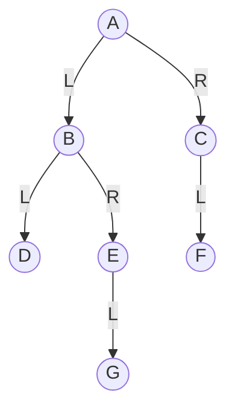
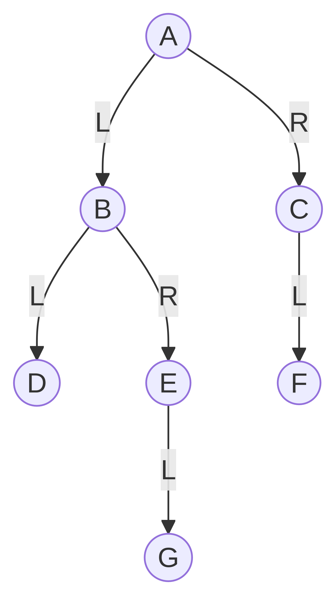
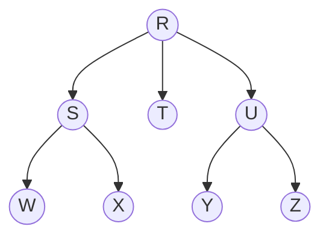
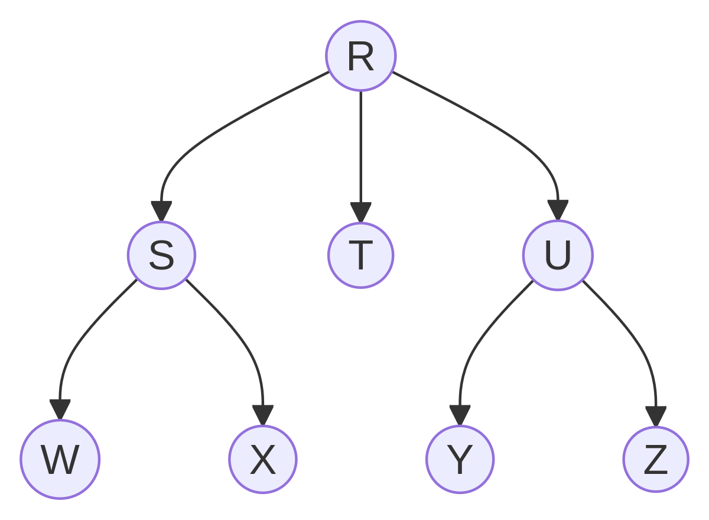

# Actividad (20%) — Árboles (Corte III)

## Tema
**Árboles**: identificación de partes, propiedades básicas y **recorridos**.

## Objetivo
Interpretar la estructura de un árbol a partir de su representación, **etiquetar** sus elementos (raíz, hojas, niveles, etc.) y obtener los **recorridos** de un árbol binario.

---

## Indicaciones generales
- Esta actividad es **principalmente teórica** (no requiere programar).
- Puedes responder en un documento (Word/Google Docs) o a mano y entregar **foto/escaneo** legible.

### Convenciones (para evitar ambigüedad)
- **Nivel de la raíz = 0**.
- **Profundidad de un nodo**: número de aristas desde la raíz hasta ese nodo.
- **Altura del árbol**: máximo número de aristas desde la raíz hasta una hoja.
- **Hoja**: nodo sin hijos.

---

## Entregable
Sube un **PDF** llamado: `apellido_nombre_arboles.pdf` con tus respuestas.

---

## Parte A — Etiquetado y análisis (Opción 2)
Resuelve los ítems para los **dos árboles** (T1 y T2).

### Árbol T1 (binario)
Representación:

1. Lista todos los **nodos** y todas las **aristas** (como pares Padre→Hijo).
2. Identifica:
  - raíz
  - hojas
  - nodos internos
3. Para cada nodo, escribe su **padre** (si tiene) y sus **hijos**.
4. Calcula:
  - cantidad total de nodos
  - cantidad total de aristas
  - altura del árbol
5. Escribe los nodos por **niveles** (nivel 0, nivel 1, …).
6. Indica si T1 es:
  - binario (sí/no)
  - estricto (cada nodo tiene 0 o 2 hijos) (sí/no)

### Árbol T2 (árbol general)
Representación:

1. Lista todos los **nodos** y todas las **aristas** (como pares Padre→Hijo).
2. Identifica:
  - raíz
  - hojas
  - nodos internos
3. Para cada nodo, escribe su **padre** (si tiene) y sus **hijos**.
4. Calcula:
  - cantidad total de nodos
  - cantidad total de aristas
  - altura del árbol
5. Escribe los nodos por **niveles** (nivel 0, nivel 1, …).

---

## Parte B — Recorridos (Opción 3)
Trabaja únicamente con el árbol **T1** (binario).

1. Escribe el recorrido **Preorden** (Raíz–Izquierda–Derecha).
2. Escribe el recorrido **Inorden** (Izquierda–Raíz–Derecha).
3. Escribe el recorrido **Postorden** (Izquierda–Derecha–Raíz).
4. (Opcional) Escribe el recorrido por **niveles** (Level-order).

---

## Criterios de evaluación (20 pts = 20%)
- **Parte A (12 pts)**
  - Identificación correcta (raíz, hojas, internos) y lista de aristas: 6 pts
  - Altura y niveles correctos (con convención indicada): 6 pts
- **Parte B (8 pts)**
  - Preorden correcto: 3 pts
  - Inorden correcto: 3 pts
  - Postorden correcto: 2 pts

---

## Recomendación de presentación
- Si respondes a mano, numera las preguntas y mantén el orden.
- Si haces diagramas adicionales, que sean claros y con nombres de nodos visibles.
