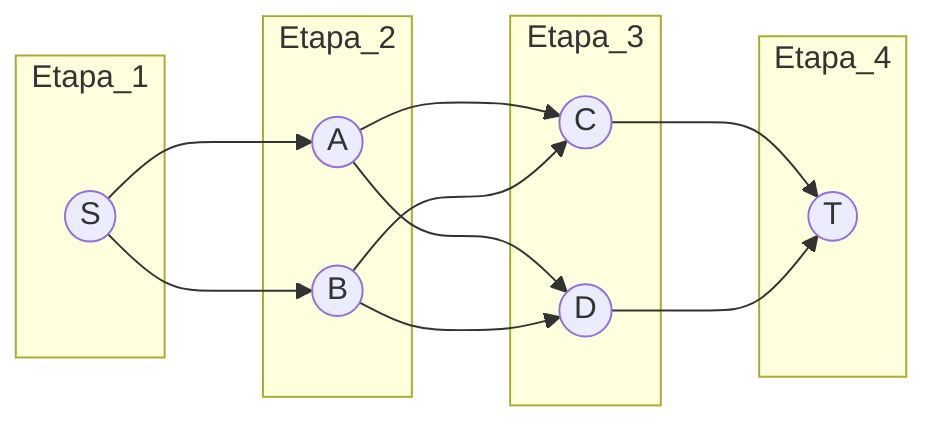

# Módulo 13 — Programación Dinámica: Grafos Multietapa

## Descripción
Introducción a la Programación Dinámica y su aplicación en grafos por etapas.

## Evaluación
0% - Práctica Guiada

---

## 1. Programación Dinámica: Idea Central
**Concepto base y motivación práctica.**

- La DP optimiza problemas complejos dividiéndolos en subproblemas superpuestos y almacenando resultados.
- **Recursividad ingenua:** repite cálculos (ej. Fibonacci). Complejidad alta.
- **DP:** calcula una vez, guarda y reutiliza. Complejidad menor.

---

## 2. Ingredientes de la DP
**Cuándo sí aplica y cuándo no.**

- **Subproblemas superpuestos:** el mismo cálculo aparece múltiples veces.
- **Óptima subestructura:** la solución global se compone de soluciones parciales óptimas.

**Checklist rápido:**
- ¿Se repiten cálculos?
- ¿Puedo definir una recurrencia?
- ¿Puedo almacenar resultados en una tabla?
- ¿Hay un orden natural de resolución?

---

## 3. Grafos Multietapa
**Estructura y contexto del problema.**

**Características:**
- Los nodos están organizados en etapas (columnas).
- Solo puedes avanzar a la etapa siguiente. No puedes volver atrás ni saltar etapas (usualmente).

**El Problema:** Queremos ir del inicio (S) al final (T) con el costo mínimo (gastando menos gasolina, dinero o tiempo).

**Intuición:** cada decisión que tomo ahora (ir por arriba o por abajo) afecta el costo final, pero no necesito mirar todo el mapa a la vez, solo el paso inmediato.



---

## 4. Orden Topológico en DAG
**Base para aplicar DP en grafos.**

En un DAG podemos calcular costos en un orden donde todos los predecesores ya están resueltos.

**Paso a paso:**
1. Identificar nodos sin predecesores.
2. Eliminar y registrar.
3. Repetir hasta vaciar.

**Resultado típico:** S → A → B → C → D → T

---

## 5. Backward Approach (Hacia Atrás)
**Recurrencia para costo mínimo.**

Para saber el camino óptimo a T, primero preguntamos:
“¿Cuál es el mejor camino desde la Etapa 3 hasta T?”

**Relación de Recurrencia**
```
cost(i, j) = min { c(j, l) + cost(i+1, l) }
```
**Donde:**
- j es un nodo en la etapa i.
- l es un vecino de j en la etapa i+1.
- c(j, l) es el peso de la arista.

**Ejemplo de decisión:**
- Opción A: 2 + 5 = 7 (Ganador)
- Opción B: 7 + 1 = 8

---

## 6. Ejemplo Guiado: Tabla de Costos
**Resolver un grafo paso a paso.**

| Nodo | Costo a T | Siguiente |
|------|-----------|-----------|
| C    | 6         | T         |
| D    | 2         | T         |
| A    | 7         | D         |
| B    | 8         | C         |

**Resultado:** Ruta óptima: S → A → D → T

---

## 7. Reconstrucción del Camino Óptimo
**Guardar decisiones para explicar la solución.**

- Además del costo, se guarda el siguiente nodo elegido.
- Permite mostrar la ruta óptima, no solo el valor.

Pseudo‑código:
```
next_node = [None] * N
for i in range(N-2, -1, -1):
  for v, w in graph[i]:
    if dist[v] + w < dist[i]:
      dist[i] = dist[v] + w
      next_node[i] = v
```

---

## 8. Memoización vs Tabulación
**Dos enfoques para la misma recurrencia.**

- **Memoización (top‑down):** recursión + caché.
- **Tabulación (bottom‑up):** tabla iterativa.

---

## 9. Complejidad y Escalabilidad
**Costos de tiempo y memoria.**

- Tiempo: `O(V + E)`
- Memoria: `O(V)`

Observación: si el grafo es denso, el costo aumenta.

---

## 10. Implementación (Python)
**Código completo y comprensible.**

```python
import sys

def shortest_dist(graph, N):
    # dist[i] almacenará la distancia mínima desde el nodo i hasta el destino (N-1)
    dist = [0] * N
    dist[N-1] = 0

    # Backward approach: calculamos desde el final hacia el inicio
    for i in range(N-2, -1, -1):
        dist[i] = sys.maxsize

        # Revisar todas las aristas que salen de i
        for v, weight in graph[i]:
            if dist[v] != sys.maxsize:
                dist[i] = min(dist[i], weight + dist[v])

    return dist[0]

# Grafo como lista de adyacencia
g = {
    0: [(1, 1), (2, 2)],
    1: [(3, 4), (4, 3)],
    2: [(3, 2), (4, 5)],
    3: [(5, 6)],
    4: [(5, 2)],
    5: []
}
print(shortest_dist(g, 6))
```

---

## 11. BST Óptimos
**Minimizar costo esperado de búsqueda.**

Si ciertos elementos se buscan más, deberían estar más cerca de la raíz.

**Idea:** elegir la raíz que minimiza el costo esperado.

Recurrencia clásica:
```
cost(i, j) = min_r { cost(i, r-1) + cost(r+1, j) + sum(freq[i..j]) }
```

---

## 12. Variaciones de DP en Grafos
**Cambiar objetivo y restricciones.**

- Camino más largo (en DAG).
- Restricciones: capacidad, presupuesto, número de saltos.
- Camino con penalización: costo base + penalizaciones.
- Multiparámetro: estados con más de una variable.

---

## 13. Mini Taller: Diseño de Etapas
**Actividad aplicada con un caso realista.**

Diseña un grafo multietapa para un sistema de entregas.

**Etapas sugeridas:**
- Centro de distribución
- Hubs regionales
- Centros locales
- Destino final

**Objetivo:**
- Definir costos
- Aplicar DP
- Explicar la ruta óptima

---

## 14. Preguntas de Repaso
- ¿Qué condiciones deben cumplirse para usar DP?
- ¿En qué se diferencian memoización y tabulación?
- ¿Cómo se reconstruye el camino óptimo?
- ¿Qué representa la suma de frecuencias en BST óptimo?
- ¿Por qué el orden topológico es importante?
